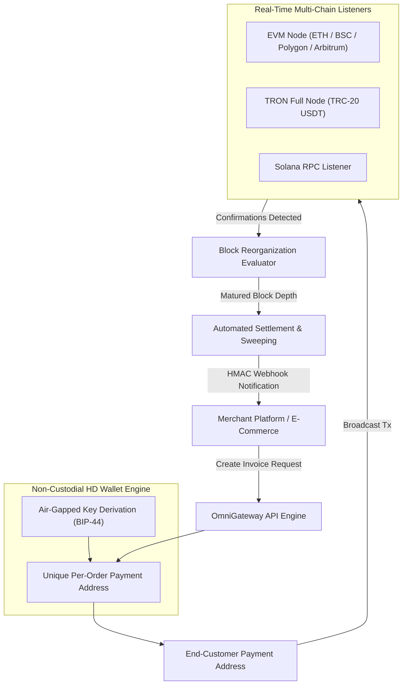

# OmniGateway — Institutional Web3 Multi-Chain Payment Suite

An enterprise multi-chain payment processor engineered for institutional non-custodial crypto invoicing, real-time blockchain transaction monitoring, and automated settlement reconciliation.

## Key Architectural Highlights

1. **Non-Custodial HD Key Derivation**: Mathematical derivation of millions of payment addresses from single secure master seeds without exposing private keys.
2. **Reorg-Resistant Ingestion**: Dynamic confirmation thresholds tailored to each network's finality profile.
3. **Gas-Optimized Batch Sweeper**: High-efficiency consolidation algorithms minimizing blockchain transaction fees by up to 65%.
4. **Guaranteed Delivery Webhook Dispatcher**: Exponential backoff retry policies and HMAC-SHA256 signature verification.

---

## 💼 Enterprise Client Demonstration & Inquiries

> **Proprietary Notice & Client Confidentiality**:  
> This public repository contains enterprise architectural blueprints, interface definitions, and design patterns. To protect institutional client confidentiality and proprietary intellectual property, production business algorithms, private contracts, and live infrastructure credentials are intentionally excluded.

### 📅 Schedule a Technical Deep-Dive
If you are an enterprise client or institutional partner evaluating our capabilities:
- **Live Platform Demos**: Available during a scheduled technical walkthrough.
- **Production Code Audits**: Comprehensive code inspection available under mutual Non-Disclosure Agreement (NDA).
- **Custom Implementations**: Full turnkey deployment, white-label customization, and bespoke engineering.

📬 **Contact for Business & Technical Inquiries:**  
- **Email**: devopsjahidulislam@gmail.com / admin@starit.farm  
- **GitHub**: [@staritfarm](https://github.com/staritfarm)  
